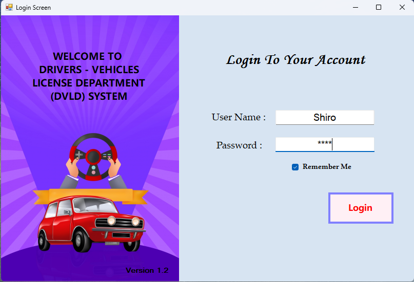
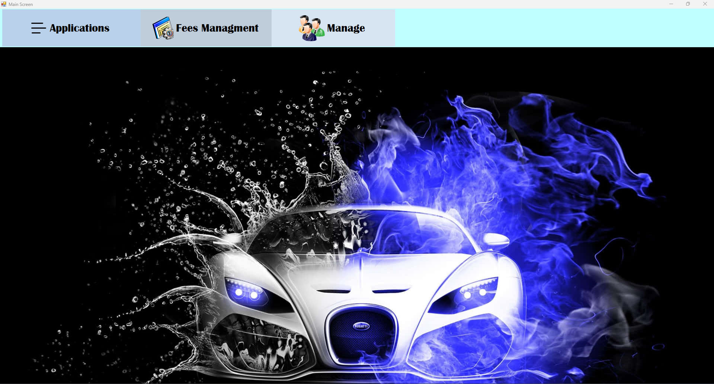
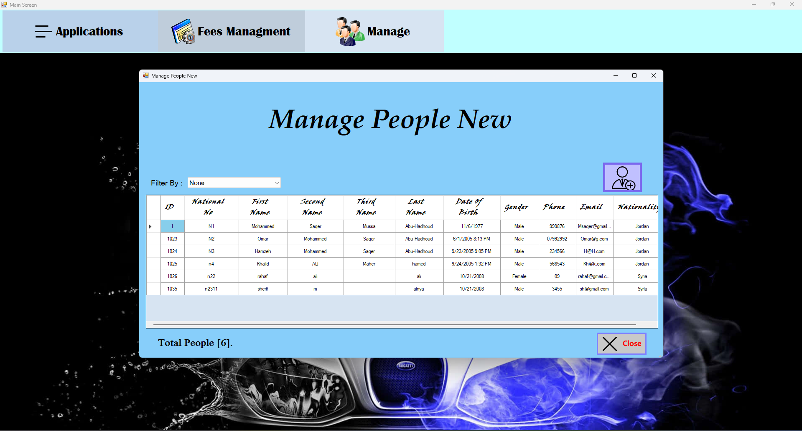
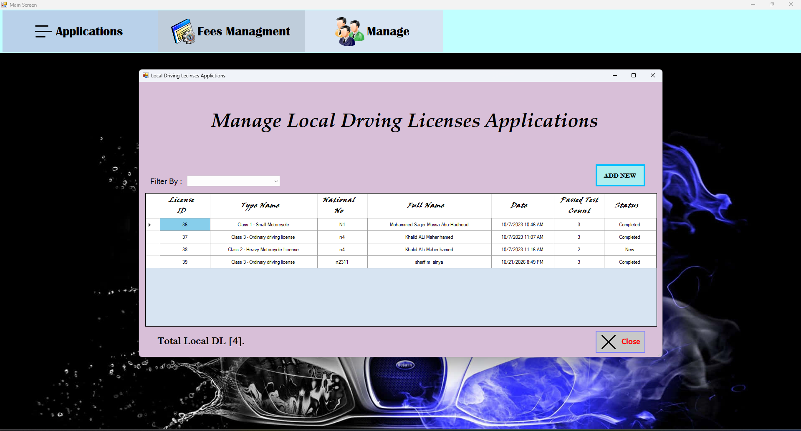

# Driving & Vehicles Licensing Department (DVLD) System 🚗

A comprehensive enterprise desktop application designed to manage and automate driving licenses and vehicle department operations. Built using **C#** and **Windows Forms**, with **SQL Server** backed by **Three-Tier Architecture**.

---

## 📁 Repository Structure
- **DVLD_MySolution.zip:** Full source code and application developed by me (Compressed file).
- **DVLD_Muhammed Abu-Hadhoud.zip:** The official instructor's solution for reference (Compressed file).
- **DatabaseFile.zip:** SQL Server backup file (`.bak`) to restore the database instantly.
- **Screenshots:** Folder containing system interface previews.

---

## 🛠️ Quick Setup & Run

### 1. Restore the Database
Extract `DatabaseFile.zip`, open **SQL Server Management Studio (SSMS)**, and execute the following query to restore the database directly:

```sql
RESTORE DATABASE DVLD 
FROM DISK = 'C:\path\to\your\extracted\DVLD.bak'
```

### 2. Run the Project
Extract `DVLD_MySolution.zip`, open the solution in **Visual Studio**, and press **F5** to start the application immediately.

---

## 📸 Screenshots

### 1️⃣ Login Screen


### 2️⃣ Main Dashboard


### 3️⃣ Manage People


### 4️⃣ Manage Local Licenses


---

@‎𝑆ℎ𝑒𝑟𝑖𝑓_𝐴𝑖𝑛𝑦𝑎

...
